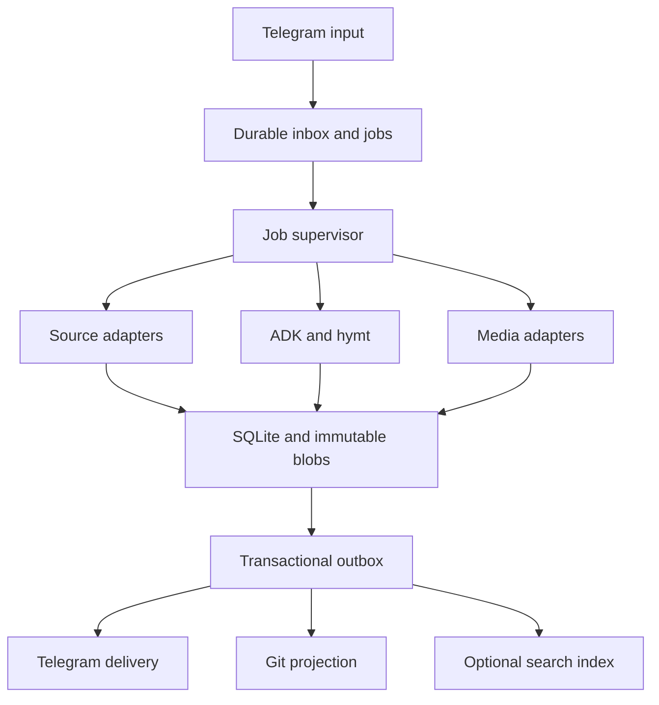

# 02 — Architecture & Runtime Contracts

## Architecture
Use one Rust workspace and service with clear adapter boundaries. Keep deterministic application behavior outside LLM control. External executables remain supported components; integrating a Python CLI does not require rewriting that tool in Rust.

Suggested workspace boundaries are domain, storage, sources, workflows, media, telegram, and application/CLI. Start with modules if separate crates add no value. Dependencies should flow from adapters toward typed domain contracts; the domain should not depend on Telegram HTTP or model SDK details.
## Typed contracts
Define serializable, versioned data types for SourceKey, SourceRevisionRef, Observation, Relation, ViewManifest, TransformRequest, TransformResult, ArtifactManifest, JobRecord, and DeliveryRecord.
A SourceKey represents provider identity, never a generated filename. A ViewManifest pins ordered source revisions and expansion policy. ArtifactManifest contains a content hash, byte size, MIME/container/codec information where applicable, duration where applicable, producer fingerprint, and provenance references.
A SourceAdapter returns extracted source objects and relations rather than a giant already-expanded Markdown file. A Renderer takes a pinned view and produces a delivery document. Translator, Summarizer, Downloader, Synthesizer, AudioFinalizer, and Sender have separate contracts.
Errors have a typed category, retryability, sanitized diagnostic, and responsible phase. Distinguish unsupported input, unavailable source, partial extraction, model truncation, cancelled work, disk exhaustion, rate limiting, failed delivery, and uncertain external side effect.
## Ingress transaction
For every Telegram update, commit the bot-scoped update identity, normalized request metadata, every child job, and the durable next-offset checkpoint in one SQLite transaction. Only then allow the next getUpdates request to confirm that update. Repeated updates are idempotent.
Polling performs bounded validation and persistence, not synchronous downloads, translation, or TTS. If a request cannot be scheduled because of a resource policy, persist a clear rejection/terminal state before advancing the offset.
Telegram identifiers are typed 64-bit integers where the protocol requires them; source IDs that exceed safe numeric representations remain strings. A reused Telegram file name never becomes a filesystem path directly.
## Worker lifecycle
Jobs move through queued, running, waiting/retry, succeeded, partial, failed, or cancelled states. Delivery and projection states are separate from processing state. Persist phase attempts, input references, configuration snapshot ID, artifact outputs, next attempt time, cancellation request, and lease/fencing information.
Claim work with a short transaction and a fencing token. Use heartbeats for long work. A stale worker cannot publish a new selected output after its lease is superseded. Put downloads, model calls, subprocess execution, and Git operations outside database write transactions.
Keep separate bounded concurrency for downloads, LLM requests, synthesis, FFmpeg, and Telegram delivery. An operator should be able to limit an expensive local model to one request while allowing downloads and polling to continue.
On shutdown, stop accepting work, cancel or drain within a configured deadline, terminate process groups, and leave recoverable state. Retain valid completed artifacts.
## ADK persistence boundary
Use ADK-Rust's supported persistent graph checkpoint mechanism for LLM graph execution. The application database remains authoritative for sources, artifacts, jobs, and side-effect receipts.
Map each workflow run to a durable job and input fingerprint. Checkpoints contain references to immutable data where possible. There is no cross-database transaction spanning a checkpoint, Telegram, Git, and application tables. Reconcile persisted outputs on resume and make node effects idempotent.
The graph selects typed transformation steps; host code performs validated persistence and delivery. Retrieved web content and model output are untrusted data, not operational instructions.
## External process contract
Invoke tools with argument arrays and explicit executable paths, never shell interpolation. Use a per-job working directory, bounded stdout/stderr, resource and elapsed-time budgets, and process-group cancellation. Resolve resulting paths inside the job directory before publishing artifacts.
Consume documented structured results. Keep human progress logs separate from structured outcomes. Record executable versions and relevant configuration in manifests. A successful exit code does not prove media validity.
Apply network-source policy to downloaded URLs and redirects. Default to public HTTP(S) source fetching; explicitly configured local LLM/TTS services are a separate allowed endpoint class. Block accidental access to loopback/private-network/metadata endpoints through arbitrary submitted URLs, and enforce redirect, size, duration, and graph-expansion budgets.
## Idempotency and side effects
Use database uniqueness and transactional outbox events for internal state. Use transform fingerprints and active-run coordination for expensive computation. Persist artifact bytes before creating durable references.
Telegram may accept a message even when the client loses the response. Record delivery_unknown and apply the documented resend policy; do not claim exactly-once sends. Git commits can be reconciled using immutable event markers and hashes before recording projection success.
Public code, user data, and runtime secrets have separate locations. Secret values are never included in stored configuration snapshots, cache keys, rendered captions, or logs. A non-secret model-deployment revision identifies backend changes that affect reproducibility.
